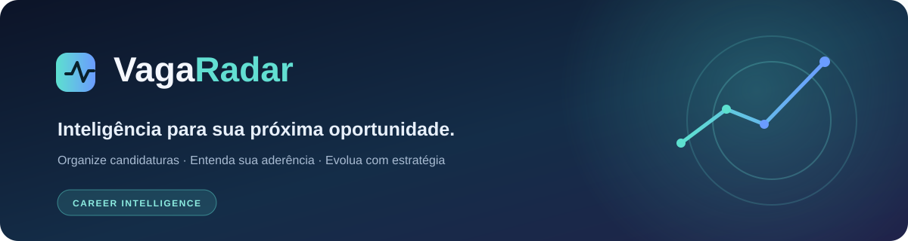
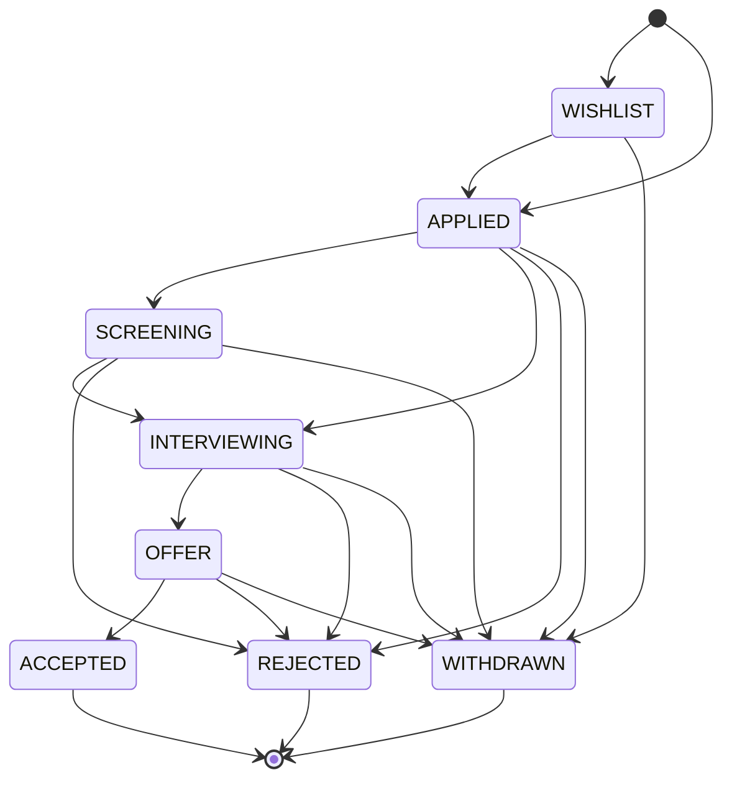
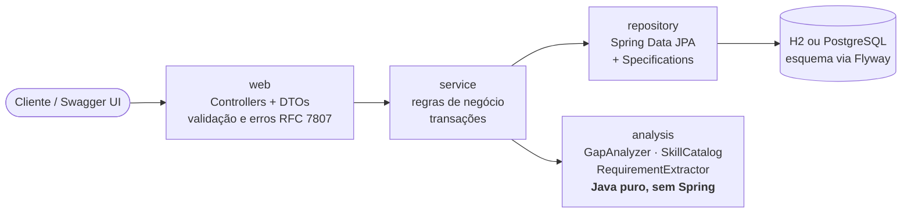
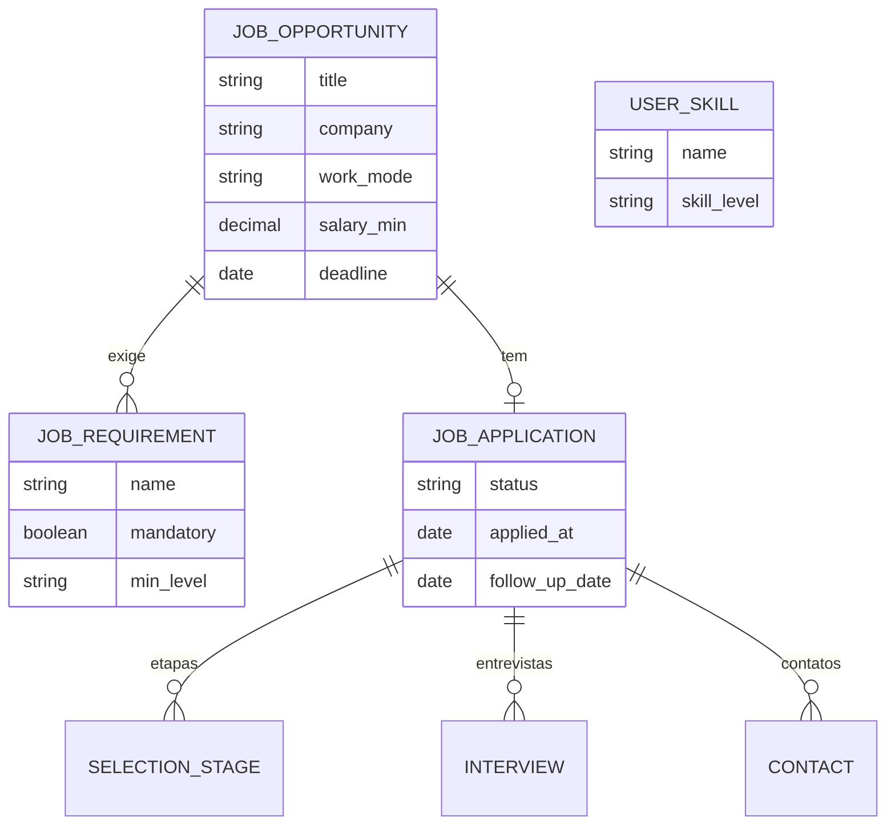

<div align="center">

# 📡 VagaRadar



**Seu radar de oportunidades: organize a busca por emprego e descubra _o que falta aprender_ para cada vaga.**

[](https://github.com/HernandesWolf/VagaRadar_H1/actions/workflows/ci.yml)


[Demonstração](#-frontend) · [O problema](#-o-problema) · [O diferencial](#-o-diferencial-análise-de-lacunas) · [Teste em 2 minutos](#-teste-em-2-minutos) · [Arquitetura](#-arquitetura) · [API](#-api) · [Testes](#-testes) · [Roadmap](#-roadmap)

</div>

---

## 🎯 O problema

Quem procura emprego acompanha dezenas de vagas ao mesmo tempo: datas-limite, etapas do processo seletivo, entrevistas, recrutadores, retornos. Tudo acaba espalhado entre e-mails, planilhas e abas do navegador, e o que se perde ali são oportunidades.

O **VagaRadar** centraliza esse processo em uma API REST e vai além de "guardar vagas": ele **compara os requisitos de cada vaga com as suas competências** e mostra, com números, onde você já é competitivo e **o que estudar primeiro**.

## ✨ O diferencial: análise de lacunas

Você declara o que sabe (com nível), cadastra a vaga com seus requisitos, e o motor responde:

- **Quão aderente** você está a cada vaga (score de 0 a 100 e um veredito);
- **Quais requisitos faltam** (separando obrigatórios de desejáveis) e quais precisam de **mais nível**;
- **Um ranking** de todas as vagas, da mais para a menos aderente;
- **Prioridades de estudo**: as tecnologias que mais aparecem como obrigatórias nas vagas em aberto em que você tem lacuna.

O motor é **100% determinístico (sem IA)**: mesmo input, mesmo resultado, fácil de auditar e de testar. Isso foi proposital: é a base sobre a qual uma camada de LLM pode ser acoplada depois, com resultados revisáveis pelo usuário (veja o [Roadmap](#-roadmap)).

### Exemplo real (dados da demonstração)

`GET /api/jobs/2/gap-analysis`, vaga _Analista de Desenvolvimento Backend_ do cenário de demonstração:

```jsonc
{
  "jobId": 2,
  "title": "Analista de Desenvolvimento Backend",
  "company": "Vetor Bank",
  "report": {
    "score": 47,
    "verdict": "Aderência parcial",
    "metCount": 1, "partialCount": 3, "missingCount": 3,
    "missingMandatory": ["Kafka"],
    "missingOptional": ["AWS", "Kubernetes"],
    "toImprove": ["Java", "Spring Boot", "PostgreSQL"],
    "results": [
      { "name": "Java",        "mandatory": true,  "requiredLevel": "ADVANCED",     "userLevel": "INTERMEDIATE", "status": "PARTIAL", "credit": 0.67 },
      { "name": "Spring Boot", "mandatory": true,  "requiredLevel": "INTERMEDIATE", "userLevel": "BEGINNER",     "status": "PARTIAL", "credit": 0.5  },
      { "name": "Kafka",       "mandatory": true,  "requiredLevel": "BEGINNER",     "userLevel": null,           "status": "MISSING", "credit": 0.0  }
      // ... (demais requisitos omitidos)
    ]
  }
}
```

E o ranking das 8 vagas da demonstração, para o mesmo perfil:

| Score | Vaga | Veredito | Obrigatório faltando |
|:--:|---|---|---|
| **100** | Desenvolvedor Java Júnior · Aurora Sistemas | Excelente aderência | — |
| **100** | Analista de Sistemas · Maré Tecnologia | Excelente aderência | — |
| **100** | Estagiário de Desenvolvimento · Faísca Labs | Excelente aderência | — |
| **82** | Engenheiro de Software Júnior · Órbita Logística | Boa aderência | — |
| **69** | Desenvolvedor Backend Java · Pixel Saúde | Boa aderência | MySQL |
| **60** | Desenvolvedor Python Júnior · Cais Dados | Aderência parcial | Python |
| **47** | Analista de Desenvolvimento Backend · Vetor Bank | Aderência parcial | Kafka |
| **47** | Desenvolvedor Full Stack Pleno · Nimbus Cloud | Aderência parcial | React, TypeScript |

> As empresas e pessoas da demonstração são **fictícias**.

### Como o score é calculado

| Situação do requisito | Crédito |
|---|---|
| Seu nível **≥** o exigido | 100% (`MET`) |
| Seu nível **<** o exigido | proporcional: `nívelSeu / nívelExigido` (`PARTIAL`) |
| Você não declarou a competência | 0% (`MISSING`) |

`score = Σ(peso × crédito) / Σ(pesos) × 100`, onde **obrigatório pesa 3** e **desejável pesa 1**. Níveis: `BEGINNER (1) < INTERMEDIATE (2) < ADVANCED (3)`.

Para a comparação não falhar por grafia, existe um **catálogo de tecnologias com apelidos**: `Spring-Boot`, `springboot` e `Spring Boot` são a mesma coisa; `postgres` → PostgreSQL; `k8s` → Kubernetes; `js` → JavaScript.

### Extração de requisitos a partir do texto da vaga

Cole a descrição da vaga em `POST /api/jobs/extract-requirements` e receba **sugestões** de requisitos (a evidência da frase vem junto, para você revisar antes de salvar). As regras reconhecem seções como _"Diferenciais"_ (→ opcional), marcadores como _"é um plus"_, e níveis como _"noções"_, _"experiência"_ ou _"sólido conhecimento"_. É a mesma interface que um LLM poderia assumir no futuro.

## 🚀 Teste em 2 minutos

### Opção 1: Docker (API + PostgreSQL)

```bash
git clone https://github.com/HernandesWolf/VagaRadar_H1.git
cd VagaRadar_H1
docker compose up --build
```

### Opção 2: Maven + interface web integrada (H2 em arquivo)

Requer **JDK 17+** e **Maven 3.9+**.

```bash
# Com dados de demonstração
mvn spring-boot:run -Dspring-boot.run.profiles=demo

# Ou banco vazio
mvn spring-boot:run
```

Acesse **http://localhost:8080**. O Spring Boot entrega a interface e a API na mesma origem. Não é necessário Node.js, npm, React, build separado ou configuração de CORS.

### Endpoints úteis

| O quê | Onde |
|---|---|
| Interface web | http://localhost:8080 |
| Swagger UI | http://localhost:8080/swagger-ui.html |
| Health check | http://localhost:8080/actuator/health |
| Ranking de aderência | http://localhost:8080/api/gap-analysis/ranking |
| Estatísticas | http://localhost:8080/api/stats |
| Alertas | http://localhost:8080/api/alerts |

> **VS Code:** o repositório já traz `.vscode/launch.json`. Instale o _Extension Pack for Java_ e use **Run and Debug → VagaRadar (com dados de demonstração)**. O arquivo [`docs/api-examples.http`](docs/api-examples.http) contém exemplos de chamadas à API.

## 🖥️ Frontend

A interface é propositalmente enxuta: **HTML5, CSS3 e JavaScript puro**, localizada em `src/main/resources/static` e servida pelo Spring Boot. O foco técnico do projeto permanece no backend Java/Spring Boot.

- Painel com indicadores, funil e alertas reais da API.
- Consulta e cadastro de vagas.
- Registro e acompanhamento de candidaturas, respeitando as transições de status definidas no backend.
- Análise de aderência e lacunas por oportunidade.
- Cadastro e manutenção de competências.
- Layout responsivo para desktop e celular.

Não existe um segundo servidor frontend: a página e os endpoints usam a mesma origem (`localhost:8080`).

> **Segurança:** o backend atual ainda não implementa autenticação/autorização. Mantenha a aplicação em ambiente local ou protegido até implementar controle de acesso.

## 🧩 Funcionalidades

| Funcionalidade | Como funciona |
|---|---|
| **Cadastro de oportunidades** | Empresa, cargo, localidade, modalidade (`REMOTE`/`HYBRID`/`ONSITE`), faixa salarial, link, descrição, prazo e requisitos |
| **Requisitos por vaga** | Obrigatório ou desejável, com nível mínimo. Atualizar a vaga _sincroniza_ os requisitos por diferença |
| **Acompanhamento de candidaturas** | Uma por vaga; status controlado por máquina de estados (veja abaixo) |
| **Etapas do processo seletivo** | Triagem, teste técnico, entrevistas… cada uma com status e prazo |
| **Entrevistas e contatos** | Data/hora, tipo, entrevistador, local/link, feedback; contatos (recrutador, gestor…) por candidatura |
| **Alertas de prazos** | Calculados sob demanda: prazo de vaga ainda sem candidatura, entrevista próxima, follow-up vencido, etapa atrasada e candidatura parada há muitos dias. Ordenados por severidade (`CRITICAL`/`WARNING`/`INFO`) |
| **Estatísticas** | Funil (enviadas → respostas → entrevistas → propostas), taxas de resposta/entrevista/proposta, distribuição por status e modalidade, tecnologias mais pedidas |
| **Filtros** | Texto livre, **tecnologia** (várias, com AND), **localidade**, **modalidade**, salário mínimo; ordenação por whitelist e paginação |
| **Análise de lacunas** | Score por vaga, ranking e prioridades de estudo (seção acima) |

### Escopo e limitações da versão atual

O VagaRadar está em evolução e, nesta versão, foi desenvolvido como uma aplicação de uso individual para demonstração e aprendizado de arquitetura backend.

- **Não possui autenticação ou autorização**: os endpoints não exigem login.
- **Não possui isolamento entre usuários**: os dados pertencem a uma única instância da aplicação.
- **Não deve ser exposto diretamente à internet nem receber dados pessoais ou sensíveis** sem a implementação prévia de controles de segurança.

Autenticação com Spring Security/JWT e suporte multiusuário estão registrados no roadmap.

### Máquina de estados da candidatura

Transições incoerentes (ex.: "aceitar" uma proposta que nunca existiu) são recusadas com **HTTP 409** e uma mensagem explicando o que é permitido a partir do estado atual.



### Como as taxas são definidas

Todas as taxas consideram só candidaturas **efetivamente enviadas** (itens na lista de desejos não contam):

- **Resposta:** a empresa reagiu (triagem, entrevista, proposta ou recusa) ou há entrevista registrada;
- **Entrevista:** status `INTERVIEWING`/`OFFER`/`ACCEPTED` ou ao menos uma entrevista registrada;
- **Proposta:** status `OFFER` ou `ACCEPTED`.

## 🏗️ Arquitetura



```text
src/main/java/com/vagaradar
├── analysis/     Motor de lacunas, catálogo de tecnologias e extrator (Java puro, sem Spring)
├── domain/       Entidades JPA e enums (ApplicationStatus contém a máquina de estados)
├── repository/   Spring Data JPA + JobSpecifications (filtros dinâmicos)
├── service/      Casos de uso e regras de negócio (@Transactional)
├── web/          Controllers REST, DTOs (records) e tratamento global de erros
└── config/       Beans, OpenAPI e carga de dados de demonstração
```

### Decisões de projeto

| Decisão | Por quê |
|---|---|
| **Motor de análise em Java puro** (pacote `analysis`) | Regra de negócio central isolada do framework: testável com JUnit simples, sem subir contexto Spring |
| **Regras determinísticas antes de IA** | Resultado explicável e reproduzível; a IA entra depois como _sugestão revisável_, não como fonte de verdade |
| **Flyway em vez de `ddl-auto`** | Esquema versionado e auditável; o mesmo SQL roda em H2 (modo PostgreSQL) e em PostgreSQL |
| **H2 por padrão, PostgreSQL via perfil/Docker** | Qualquer pessoa roda o projeto em segundos, sem instalar banco |
| **DTOs como `record`** | Imutáveis e concisos; as entidades JPA nunca vazam para a API |
| **Erros em `ProblemDetail` (RFC 7807)** | Contrato de erro padronizado: 400 (validação, com erro por campo), 404, 409 (regra de negócio) |
| **`Clock` injetável** | Regras que dependem de "hoje" (alertas, datas de candidatura) ficam testáveis |
| **Alertas calculados sob demanda** | Sem agendador nem estado duplicado: o alerta sempre reflete os dados atuais |
| **Ordenação por whitelist** | Evita expor nomes internos de campos e injeção via parâmetro `sortBy` |
| **`open-in-view: false`** | Acesso ao banco só dentro da camada de serviço, sem _lazy loading_ escondido em controllers |

### Modelo de dados



## 🔌 API

Documentação interativa completa em **`/swagger-ui.html`**. Resumo:

| Recurso | Endpoints |
|---|---|
| **Competências** | `GET/POST /api/skills` · `PUT/DELETE /api/skills/{id}` |
| **Vagas** | `GET/POST /api/jobs` · `GET/PUT/DELETE /api/jobs/{id}` |
| **Análise de lacunas** | `GET /api/jobs/{id}/gap-analysis` · `GET /api/gap-analysis/ranking` · `GET /api/gap-analysis/study-priorities` |
| **Extração de requisitos** | `POST /api/jobs/extract-requirements` |
| **Candidaturas** | `GET/POST /api/applications` · `GET/PUT/DELETE /api/applications/{id}` · `POST /api/applications/{id}/status` |
| **Etapas** | `GET/POST /api/applications/{id}/stages` · `PUT/DELETE …/stages/{stageId}` |
| **Entrevistas** | `GET/POST /api/applications/{id}/interviews` · `PUT/DELETE …/interviews/{interviewId}` |
| **Contatos** | `GET/POST /api/applications/{id}/contacts` · `PUT/DELETE …/contacts/{contactId}` |
| **Painel** | `GET /api/stats` · `GET /api/alerts?days=7` |

Busca com filtros combinados:

```bash
curl "http://localhost:8080/api/jobs?technology=java&technology=postgres&workMode=REMOTE&location=fortaleza&sortBy=deadline&direction=asc"
```

Exemplo de erro padronizado (transição de status inválida → `409`):

```json
{
  "title": "Regra de negócio violada",
  "status": 409,
  "detail": "Transição não permitida: APPLIED → OFFER. Permitidas a partir de APPLIED: [SCREENING, INTERVIEWING, REJECTED, WITHDRAWN]"
}
```

## 🧪 Testes

São **35 testes automatizados**, em três níveis:

| Nível | Qtde | O que cobre |
|---|:--:|---|
| **Unitários (Java puro)** | 21 | Cálculo do score e pesos, créditos parciais, agregação de lacunas, apelidos do catálogo, extração de requisitos e a máquina de estados |
| **Integração ponta a ponta** (`MockMvc` + JPA + H2 + Flyway) | 11 | Validação (400), conflitos (409), filtros combinados, sincronização de requisitos, ciclo de vida da candidatura, exclusão em cascata, estatísticas e alertas |
| **Cenário de demonstração** | 3 | A carga de dados fictícios roda de ponta a ponta e produz exatamente as estatísticas, alertas e ranking esperados |

```bash
mvn test        # roda tudo
mvn verify      # o mesmo que o CI executa a cada push
```

## 🗺️ Roadmap

- [ ] **Camada de LLM opcional** (resumir a descrição da vaga e categorizar requisitos), sempre como _sugestão revisável_, reaproveitando a interface do `RequirementExtractor`
- [ ] Autenticação (Spring Security + JWT) e multiusuário
- [ ] Testes com Testcontainers (PostgreSQL real) no CI
- [x] Interface web leve (HTML/CSS/JavaScript) servida pelo Spring Boot\n- [ ] Edição e exclusão de oportunidades pela interface\n- [ ] Detalhamento completo de candidaturas (etapas, entrevistas e contatos)\n- [ ] Autenticação e autorização antes de disponibilizar o produto publicamente
- [ ] Notificações de alertas por e-mail
- [ ] Importação de vagas por link

## 🧰 Stack da interface

| Tecnologia | Uso |
|---|---|
| HTML5 | Estrutura das telas |
| CSS3 | Layout responsivo e identidade visual |
| JavaScript | Navegação, formulários e consumo da API via Fetch |
| Spring Boot Static Resources | Entrega da interface na mesma origem da API |

## 🇺🇸 In short (English)

**VagaRadar** is a Spring Boot 3 / Java 17 REST API for managing a job search: opportunities, applications (with a validated status state machine), selection stages, interviews, contacts, deadline alerts and funnel statistics. Its differentiator is a **deterministic skill-gap engine** (no AI) that scores each job against the user's declared skills, ranks all jobs by fit and suggests what to study first, with a rule-based requirement extractor designed to be swapped or complemented by an LLM later. Persistence uses Flyway-versioned SQL on H2 (zero-config) or PostgreSQL (Docker Compose); the API is documented with OpenAPI/Swagger UI and covered by 35 automated tests.

Quick start: `mvn spring-boot:run -Dspring-boot.run.profiles=demo` → http://localhost:8080/swagger-ui.html

## 👤 Autor

Feito por **[HernandesWolf](https://github.com/HernandesWolf)** como parte da minha jornada de aprendizado em Java e Spring Boot.
💼 [LinkedIn](https://www.linkedin.com/in/ernandes-j-barboza-a455232b5/)

Se o projeto foi útil ou interessante, uma ⭐ ajuda bastante!

## 📄 Licença

Distribuído sob a licença MIT. Veja [`LICENSE`](LICENSE).
